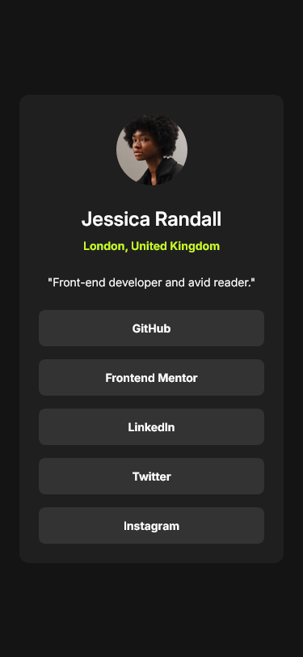
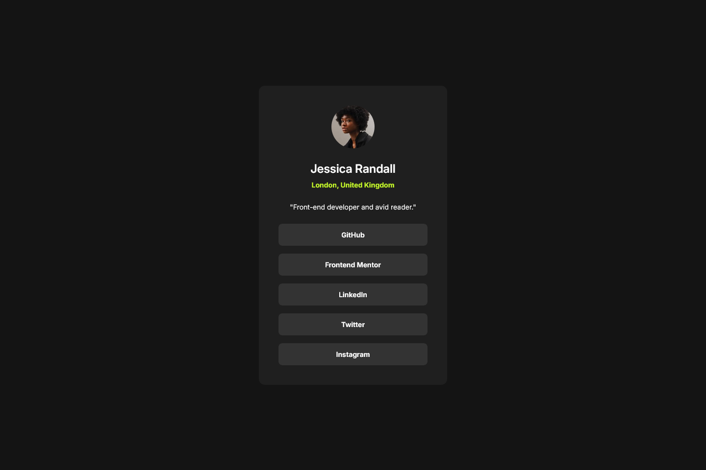

# Frontend Mentor - Social links profile solution

This is a solution to the [Social links profile challenge on Frontend Mentor](https://www.frontendmentor.io/challenges/social-links-profile-UG32l9m6dQ). Frontend Mentor challenges help you improve your coding skills by building realistic projects.

## Table of contents

- [Overview](#overview)
  - [The challenge](#the-challenge)
  - [Screenshot](#screenshot)
  - [Links](#links)
- [My process](#my-process)
  - [Built with](#built-with)
  - [What I learned](#what-i-learned)
  - [Continued development](#continued-development)
  - [AI Collaboration](#ai-collaboration)
- [Author](#author)

## Overview

### The challenge

Users should be able to:

- See hover and focus states for all interactive elements on the page

### Screenshot

- Mobile 📱



- Desktop 💻



### Links

- Solution URL: [Add solution URL here](https://your-solution-url.com)
- Live Site URL: [Add live site URL here](https://your-live-site-url.com)

## My process

### Built with

- Semantic HTML5 markup
- CSS
  - Custom properties
  - Flexbox and Grid
  - Nesting
- Mobile-first workflow

### What I learned

I followed a mobile-first workflow and paid special attention to interactivity. I decided to wrap transitions under a media query that respects the user's reduced-motion setting, I wanted to include this because I care about accessibility.

```css
a {
  /* Link styles */
  @media (prefers-reduced-motion: no-preference) {
    /* Using a slower transition for a soft fade-out effect */
    transition: color 0.6s ease-out, background-color 0.6s ease-out;

    &:hover, &:focus-visible {
      /* Using a faster transition to respond quickly to user interaction */
      transition: color 0.3s ease-out, background-color 0.3s ease-out;
    }
  }
}
```

### Continued development

I believe I still need to learn how to use AI to streamline UI verification and catch potential issues, not only in design fidelity but also in accessibility and usability. These checks would help me in future projects. In particular, I want to focus on color contrast, font sizes, and semantics.

### AI Collaboration

I used Claude Code as a mentor for guidance. It helped me out with details I was unsure of such as choosing particular tags over others, accessibility considerations, and fixing Lighthouse issues. Also, Claude helped me write the commits so I could focus on the technical side.

What worked well was that Claude forced me to think through my decisions thoroughly and consider options that I had not thought of.

Probably what did not work well was that at some point I could get distracted with some things that expanded the conversation and that maybe did not bring value to the project or that were not used at all. This makes me think of the importance of knowing when to redirect the conversation to what really matters.

## Author

- Website - [juanbonilla.me](https://juanbonilla.me)
- Frontend Mentor - [@juanpb96](https://www.frontendmentor.io/profile/juanpb96)
- [LinkedIn](https://www.linkedin.com/in/juanpablobonilla/)
